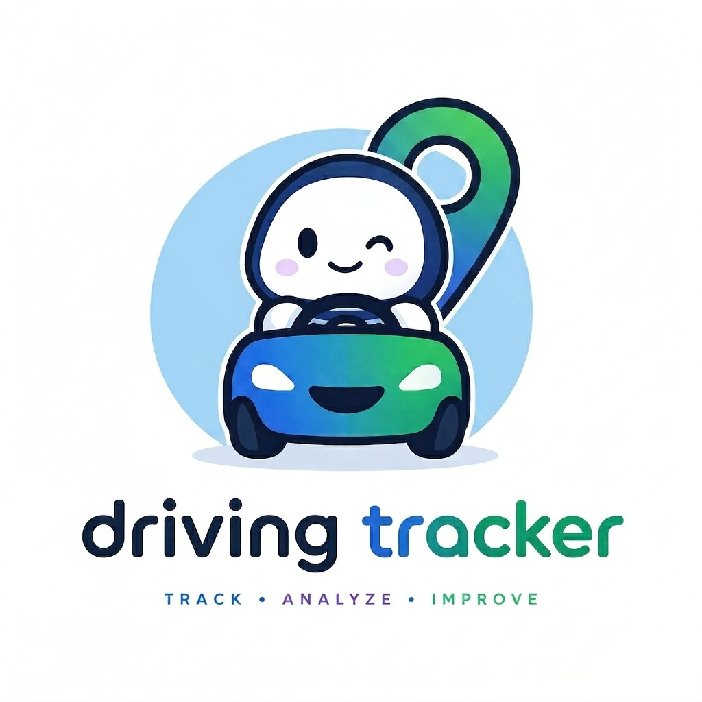
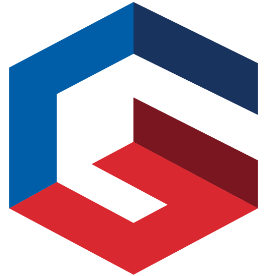
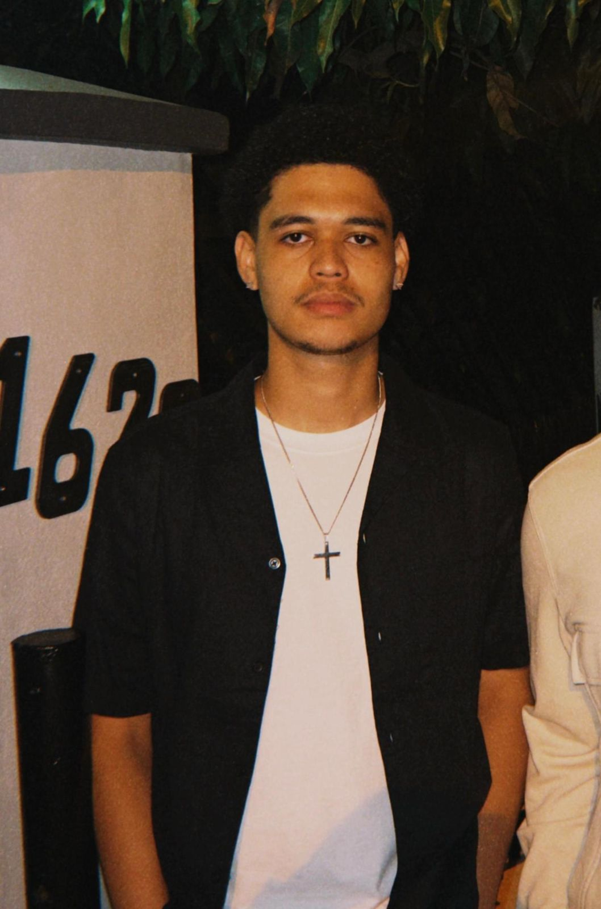

<div align= "center">
  
  
  <br/>
  
  
  

<br/>


</div>

> An intelligent Android driving companion that unifies sensor fusion, vehicle diagnostics, behavioural analytics, and social engagement into one platform - making safer, more efficient driving accessible and rewarding for everyday drivers.

<p align="center">
  
  <a href="https://codecov.io/gh/COS301-SE-2026/Driving-Tracker">
    
  </a>
  
  <a href="https://github.com/COS301-SE-2026/Driving-Tracker/pulls">
    
  </a>
  <a href="https://sentemngomez.github.io/upptime">
    
  </a>
  
  
</p>

<h2>Client</h2>
</br>
 
Gendac (Software, Innovations & IoT)

---

## Table of Contents

- [Project Description](#project-description)
- [Documentation](#documentation)
- [Demos & Project Management](#demos--project-management)
- [Deployed Pages](#deployed-pages)
- [Meet OmniTech](#meet-omnitech)
- [Tech Stack](#tech-stack)
- [Branching Strategy](#branching-strategy)
- [Getting our app](#getting-our-app)
- [Getting Started(Development)](#prerequisites)
  - [Prerequisites](#prerequisites)
  - [Running](#running)


---

## Project Description

Driving Tracker is a COS 301 Capstone Project developed for Gendac (Software, Innovations & IoT). It is a next-generation Android driving assistant that brings together phone sensors, maps, and OBD-II vehicle data to analyse driving behaviour, fuel efficiency, and vehicle health - wrapped in gamification and social features to make safer driving engaging and rewarding.

The system operates across three layers:
- **Data Collection** - phone sensors, GPS, and Bluetooth OBD-II (ELM327) provide a 360° view of vehicle and driver behaviour.
- **Intelligent Analysis** - a modular Azure-hosted backend processes driving patterns, safety scores, eco-driving insights, and vehicle health in real time.
- **Engagement** - leaderboards, badges, weekly challenges, and a family safety network transform raw data into a motivating experience.

---

## Documentation
[Software Requirement Specification](docs/Documentation-Demo4/DEMO_4_SRS.pdf)\
[Software Architecture Specification](docs/Documentation-Demo4/DEMO_4_SAS.pdf)\
[Coding Standards](docs/Documentation-Demo4/Coding-Standards.md)\
[Testing Policy](docs/Documentation-Demo4/testing-policy.md)\
[User Manual](docs/Documentation-Demo4/User%20Manual.pdf)\
[Brand style guide](docs/Documentation-Demo4/brand_style_guide.pdf)\
[Wireframes](docs/Documentation-Demo2/wireframes.pdf)\
[Wireframes Figma Link](https://www.figma.com/design/JEv1W9Jh1mvtZmtRENtL85/Wireframes?node-id=0-1&t=x2XNBSR5ZJ1KePqF-1)

---

## Demos & Project Management
[▶ **App showcase video**](https://drive.google.com/file/d/1rC_vPJdh-C7h1PiZo3ekdKXx1F-0i0wj/view)

[Github Project Board](https://github.com/orgs/COS301-SE-2026/projects/56)\
[Demo1 video](docs/Documentation-Demo1/Demo1.mp4)\
[Demo2 video](docs/Documentation-Demo2/Demo2.mp4)\
[Demo3 video](docs/Documentation-Demo3/Demo3.mp4)\
[Demo4 video](docs/Documentation-Demo4/Demo4_Video.mp4)

---
## Deployed Pages
[Landing Page (Including Brand Style Guide and Dashboard)](https://driving-tracker-seven.vercel.app/)

---

## Meet OmniTech

| |
|:---:|
| **Brayden Butler • brayden9011@gmail.com** |
| Team Lead • Backend |
| BSc Computer Science student with experience in full-stack development, backend systems, Android applications and team leadership. Interested in software engineering, scalable systems and solving real-world problems through technology. Always looking to learn, build and grow as a developer while taking initiative and embracing leadership opportunities. Outside of coding I enjoy investment analysis, volleyball and gaming. |
| [](https://github.com/Brayden-ux) [](https://www.linkedin.com/in/brayden-mm-butler/) |

| |
|:---:|
| **Sentelweyinkhosi Mngomezulu • mngomezulu.sentelwe@gmail.com** |
| Backend Engineer |
| I am an aspiring security-oriented software engineer with hands-on IT support and networking experience, focused on building secure software solutions. Experienced in Kotlin, TypeScript, Java and React among others, with practical security skills built through CTF challenges using tools like Burp Suite. Passionate about the intersection of software engineering and cybersecurity, and driven to learn by tackling difficult problems. Outside tech, I produce music: beat making, mixing and vocals.|
| [](https://github.com/SenteMngomez) [](https://www.linkedin.com/in/sentelweyinkhosi-mngomezulu?) |

| |
|:---:|
| **Mosa Leiee • mosalleiee@gmail.com** |
| Frontend & Integration Engineer |
| I am a BSc Computer Science student with experience in web and Android development and a strong interest in frontend engineering and cybersecurity. I enjoy creating intuitive, visually appealing, and user-friendly applications while exploring new areas of technology and expanding my knowledge. I am a hardworking and adaptable individual who values collaboration, problem-solving, and continuous learning. I am always open to new opportunities that allow me to grow both personally and professionally, challenge myself, and develop new skills. Outside of technology, I am passionate about fitness, particularly running, which has taught me the importance of discipline, perseverance, and consistency in working towards my goals. |
| [](https://github.com/Mosa-L) [](https://www.linkedin.com/in/mosa-leiee?) |

| |
|:---:|
| **Kundai Ndemera • kjndemera@gmail.com** |
| UI/UX Designer |
| I am an aspiring UI/UX designer passionate about creating intuitive, user-friendly, and visually engaging digital experiences. As a Computer Science student at the University of Pretoria, I have a background in web design and programming, with a growing interest in how technology and innovation can solve real-world problems. I value creativity, teamwork, communication, and continuous improvement, and I approach every design challenge as an opportunity to learn and build better solutions. Outside of technology, I am interested in digital diplomacy and the ethical use of emerging technologies.|
| [](https://github.com/kundaindemera) [](https://www.linkedin.com/in/kundai-ndemera?) |

| |
|:---:|
| **Lesedi Padi • lesedipadi@gmail.com** |
| Backend Engineer |
| I am an aspiring backend and full-stack developer passionate about learning new technologies and frameworks. I have experience building scalable backends with Node.js and TypeScript, alongside knowledge of React.js, HTML, and CSS. I value teamwork, collaboration, and continuous improvement. I believe that hard work, consistency, and a willingness to learn are key to success, and I approach every challenge as an opportunity to grow and build better solutions. Outside of code, I play tennis aiming to better my footwork and back hand.|
| [](https://github.com/Padi-le) [](https://www.linkedin.com/in/lesedi-padi-b90ba3271?) |

---

## Tech Stack

| Layer | Technologies |
|-------|-------------|
| **Mobile** | Kotlin, Android Sensor API, Mapbox, Bluetooth OBD (ELM327), Retrofit |
| **Backend** | Node.js, Express, REST API, WebSockets, JWT Auth |
| **Database** | PostgreSQL, Redis |
| **Infrastructure** | Microsoft Azure App Service, Azure Functions, Azure Blob Storage |
| **Web Dashboard** | React, Next.js, TypeScript, Tailwind CSS |

---

## Branching Strategy

| Branch | Purpose |
|--------|---------|
| `main` | Stable, prod-ready releases only |
| `develop` | Integration branch - all PRs merge here and new branches branch from here|
| `feature/name/description` | New feature development |
| `fix/name/description` | Bug fixes |
| `docs/name/description` | Documentation updates |
| `chore/name/description` | Config, tooling, setup |

---
## Getting our app

To download the Driving Tracker application, visit our deployed landing page:
[Driving Tracker Landing Page](https://cos301-se-2026.github.io/Driving-Tracker/)

Explore the features and learn more about the app, then click the **Download** button located in the navigation bar at the top of the page or in the footer section.

You can also access additional information about the app, including its features, documentation, and user guides, directly from the landing page.

---

## Getting Started (Install + Run from Scratch)

This project is composed of 3 parts:
- Backend API (Node/Express) 
- Frontend dashboard (Next.js)
- Android app (Android Studio/Gradle)

### Prerequisites

Install every tool below before continuing. Each one is required.

---

#### 1. Node.js (v20)

Node.js is the runtime that powers the backend and frontend build tools. We use version 20.

The recommended way to install Node.js is through **nvm** (Node Version Manager), which lets you install and switch between Node versions without conflicts.

``` bash
#install nvm
curl -o- https://raw.githubusercontent.com/nvm-sh/nvm/v0.39.0/install.sh | bash

#reload shell
source ~/.bashrc #bash users
OR 
source ~/.zshrc #zsh users

#Install Node 20
nvm install 20
nvm use 20

#verify
node --version #must show v20.x.x
```

#### 2. Yarn

Yarn is the package manager used for both the backend and frontend. It is enabled through **corepack**, which ships with Node.js - no separate download needed.
```
corepack enable
corepack prepare yarn@stable --activate

#verify
yarn --version
```

> If you see `command not found: corepack`, your Node.js version is too old. Re-run the nvm steps above.

#### 3. Docker Desktop

Docker runs the backend, frontend, and PostgreSQL database inside isolated containers. This means you do not need to install or configure a database manually - Docker handles everything.

Download and install Docker Desktop for your operating system:
- **macOS:** https://www.docker.com/products/docker-desktop
- **Windows:** https://www.docker.com/products/docker-desktop
- **Linux:** https://docs.docker.com/engine/install/

After installation, open Docker Desktop and wait for it to finish starting.

**Verify:**
```bash
docker --version
docker compose version    # must show v2.x or higher
```

> **Windows users:** Docker Desktop requires WSL 2 (Windows Subsystem for Linux). The installer will prompt you to enable it if needed. Follow the prompts and restart when asked.

---

#### 4. Android Studio 

Android Studio is the official IDE for building the Android app. It includes the Kotlin compiler, Android SDK, emulator and all build tools.

Download from: https://developer.android.com/studio

Run the installer and follow all default prompts. When the **SDK Components Setup** screen appears, ensure these are checked:
- Android SDK
- Android SDK Platform (API 34)
- Android Virtual Device
- Android Emulator

**Verify:**
After installation, open Android Studio. If it opens without errors and shows the welcome screen, it is installed correctly.

### Running

First Time - Build and Start
```bash
docker compose up --build
```

This will:
1. Build the backend and frontend Docker images
2. Start a PostgreSQL database and apply the schema automatically
3. Start the backend API
4. Start the frontend dashboard

Seed mock data in Docker:
```bash
docker compose run --rm seed
```

This runs the Prisma seed script inside the backend container after PostgreSQL and migrations are ready.


## Daily Development

```bash
# Start all services (no rebuild - faster for daily use)
docker compose up

# Start in background so terminal stays free
docker compose up -d

# Stop all services
docker compose down

# View live logs from all services
docker compose logs -f

# Rebuild images after pulling changes that modify dependencies or Dockerfiles
docker compose up --build

# Full reset - stops everything and wipes the database
# Use this if your database gets into a broken state
docker compose down -v
docker compose up --build

#Run prisma studio to see DB tables and data
docker compose up --build studio

#Running migrations with docker-compose
MIGRATION_NAME=example_name docker compose up --build migrate-dev

#Running integration tests through docker
docker compose run --rm api-test

#Loading migrations into DB
DATABASE_URL='...' docker compose run --rm prisma-migrate
